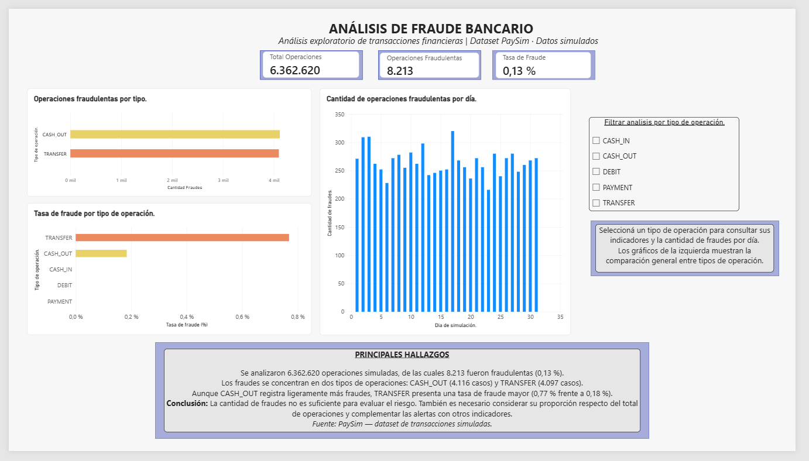

# ANÁLISIS DE FRAUDE BANCARIO
### De los datos a la identificación de riesgos financieros

**Autora:** Lucía Florencia Coppa  
**Curso:** Herramientas básicas para el Análisis de Datos – UTN  
**Proyecto:** Trabajo Final Integrador  
**Herramientas:** Python · Pandas · Matplotlib · Seaborn · Power BI

---

## 01 | Presentación del proyecto

### ¿Cómo puede el análisis de datos contribuir a identificar operaciones financieras sospechosas?

Este proyecto analiza **6.362.620 transacciones financieras simuladas** para identificar patrones asociados al fraude, evaluar indicadores de riesgo y estudiar la efectividad de un sistema de alertas.

### ¿Por qué elegí este tema?

Elegí trabajar con fraude bancario porque actualmente me desempeño en el sector financiero y me interesa comprender cómo el análisis de datos puede contribuir a identificar riesgos y mejorar los procesos de prevención.

Desde mi experiencia laboral, considero importante comprender no solo las operaciones financieras, sino también los patrones y comportamientos que pueden representar situaciones de riesgo.

Este proyecto me permitió relacionar mi experiencia profesional con los conocimientos adquiridos durante el curso, transformando datos en información útil para la toma de decisiones.

---

## 02 | Origen de los datos

Se utilizó **PaySim**, un conjunto de datos de transacciones financieras simuladas.

**Fuente:** [PaySim – Kaggle](https://www.kaggle.com/datasets/ealaxi/paysim1)

| Característica | Descripción |
|---|---|
| Registros | 6.362.620 operaciones |
| Tipos de transacción | CASH_IN, CASH_OUT, DEBIT, PAYMENT y TRANSFER |
| Variables | Importes, saldos, tipo de operación e indicadores de fraude |
| Período | 31 días de simulación |
| Naturaleza | Datos sintéticos |

El archivo original supera los 470 MB, por lo que se proporciona un enlace a su fuente en lugar de incorporarlo directamente al repositorio.

---

## 03 | Preguntas de análisis

Para orientar la investigación se plantearon cinco preguntas:

1. ¿Qué tipos de transacciones concentran la mayor cantidad de fraudes?
2. ¿Cuál es la tasa de fraude según el tipo de operación?
3. ¿Cómo se diferencian los importes fraudulentos de los legítimos?
4. ¿Cómo se distribuyen los fraudes durante los días de simulación?
5. ¿Qué proporción de fraudes identifica el sistema de alertas?

---

## 04 | Metodología

El proyecto se desarrolló en tres etapas:

**Preparación de datos — Python y Pandas**

Se verificaron los tipos de datos, valores nulos, registros duplicados y valores atípicos.

**Análisis exploratorio — Matplotlib y Seaborn**

Se estudiaron los tipos de transacción, los importes, la distribución temporal y los indicadores de fraude.

**Visualización — Power BI**

Se construyó un dashboard con indicadores principales, gráficos comparativos y un filtro por tipo de operación.

---

## 05 | Indicadores principales

| Indicador | Resultado |
|:---|---:|
| Operaciones analizadas | **6.362.620** |
| Operaciones fraudulentas | **8.213** |
| Tasa general de fraude | **0,13 %** |
| Fraudes en CASH_OUT | 4.116 |
| Fraudes en TRANSFER | 4.097 |
| Fraudes detectados por alertas | 16 |

---

## 06 | Dashboard de fraude bancario

### ¿Qué permite analizar?

El dashboard presenta tres indicadores principales y tres visualizaciones:

- Cantidad de operaciones fraudulentas por tipo.
- Tasa de fraude según el tipo de transacción.
- Evolución de la cantidad de fraudes por día de simulación.

**Interactividad:** filtro por tipo de operación.

---

## 07 | Principales hallazgos

### El fraude se concentra en dos tipos de operaciones

Los 8.213 casos fraudulentos se distribuyen entre CASH_OUT (4.116) y TRANSFER (4.097).

### TRANSFER presenta mayor riesgo relativo

Aunque CASH_OUT registra ligeramente más casos, TRANSFER presenta una tasa de fraude aproximada del **0,77 %**, frente al **0,18 %** de CASH_OUT.

### Las alertas tienen una cobertura limitada

El indicador `isFlaggedFraud` identifica solamente **16 de los 8.213 fraudes**, equivalente a aproximadamente **0,19 %** de los casos fraudulentos.

Esto evidencia que, dentro de la simulación, la regla de alerta tiene una capacidad de detección muy limitada.

---

## 08 | Conclusiones

El análisis permitió identificar diferencias importantes entre la cantidad de fraudes y su frecuencia relativa según el tipo de operación.

Los resultados muestran que evaluar únicamente el volumen de casos puede ser insuficiente para comprender el riesgo.

También se observó la importancia de complementar las alertas existentes con otros indicadores y patrones de comportamiento.

**Conclusión principal:** el análisis de datos permite transformar registros transaccionales en información útil para investigar riesgos y apoyar decisiones de prevención.

---

## 09 | Archivos del proyecto

| Recurso | Acceso |
|---|---|
| Análisis exploratorio en Python | [Ver notebook](notebooks/Analisis_Fraude_Bancario_FINAL-.ipynb) |
| Dashboard | [Ver imagen](dashboard/Dashboard_Fraude_Bancario.png) |
| Información del dataset | [Ver carpeta de datos](data/raw/README.md) |
| Dataset original | [Consultar Kaggle](https://www.kaggle.com/datasets/ealaxi/paysim1) |

---

*Trabajo Final Integrador – UTN*

*Los datos utilizados son simulados y no corresponden a operaciones reales de una entidad financiera.*
